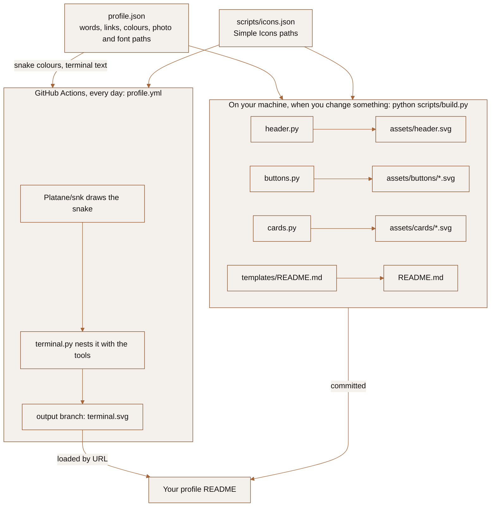

# github-profile-kit

The code behind my GitHub profile at [github.com/jandoni](https://github.com/jandoni), turned into a kit you can point at your own words, links, photo and colours. Everything on the page is an SVG built from one config file: an animated header, pill buttons, a terminal window that frames the contribution snake and the tools I use, and cards for publications or projects.

<p align="center">
  <a href="docs/preview.png"></a>
</p>

The header types itself out once when the page loads:

<p align="center">
  
</p>

`GUIDE.md` tells the longer story: what GitHub allows in a README, what I tried and dropped, and why each piece looks the way it does.

## How it fits together



The header, buttons and cards change only when you edit them, so you build them on your machine and commit them. The terminal holds the contribution snake, which changes every day, so a scheduled workflow draws the snake on GitHub's servers, nests it in the terminal and publishes the result to an `output` branch that the README loads.

## Quick start

You need Python 3.9 or newer (on macOS the command is `python3`).

1. Click **Use this template** and name the new repository exactly your GitHub username. A repository named after you is your profile repository: GitHub shows its `README.md` on your profile page.
2. Clone it and copy the example config:
   ```sh
   cp profile.example.json profile.json
   ```
3. Edit `profile.json`. The example is my own profile, so replace the username, headline, links, tools and cards, and point the photo and font paths at files on your machine (see [Photos and fonts](#photos-and-fonts)).
4. Install Pillow, which crops and embeds the photos:
   ```sh
   pip install pillow
   ```
5. Fetch the icon paths for the tools and buttons you configured:
   ```sh
   python scripts/fetch_icons.py
   ```
6. Build the header, buttons and cards:
   ```sh
   python scripts/build.py
   ```
7. Copy `templates/README.md` to your repository root as `README.md`. This command does the copy and fills in your links and alt text from the config (it replaces this kit README, which is what you want in a profile repository):
   ```sh
   python scripts/build.py --readme README.md
   ```
8. Delete the `profile.json` line from `.gitignore` (the daily workflow reads the terminal and snake settings from it), then commit `README.md`, `assets/` and `profile.json` and push.
9. Open the **Actions** tab. If GitHub asks, enable workflows for the repository.
10. Run the workflow once: **Actions**, then **profile**, then **Run workflow**. It creates the `output` branch with `terminal.svg`, and from then on it runs every day at 06:23 UTC.

To check the result before pushing, build a terminal from a snake you already have and open the local preview:

```sh
curl -s --create-dirs -o dist/snake-light.svg https://raw.githubusercontent.com/jandoni/jandoni/output/snake-light.svg
python scripts/terminal.py --snake dist/snake-light.svg
python scripts/preview.py        # then open dist/preview.html
```

`preview.py --png file.png --gif file.gif` also saves a screenshot and the header animation, if you have Playwright (`pip install playwright && playwright install chromium`). That is how the images at the top of this page were made.

## The components

| Script | Output | What it draws |
| --- | --- | --- |
| `scripts/header.py` | `assets/<header.file>.svg` | Paper gradient, your photo fading in on the right, the headline typed one character at a time, the title line typed under it. |
| `scripts/buttons.py` | `assets/buttons/<file>.svg` | Rounded pill buttons in the accent colour with an icon and a label. |
| `scripts/terminal.py` | `dist/terminal.svg` | A terminal window: a typed command, the snake, a caption, a second command, a grid of tool icons with names, a blinking cursor. |
| `scripts/cards.py` | `assets/cards/<file>.svg` | Dark cards with an inset photo or a typographic panel, a title, a short text, a label and a pill button, with the fonts embedded. |
| `scripts/build.py` | all of the above except the terminal | Runs header, buttons and cards; `--readme` also renders the README template. |
| `scripts/fetch_icons.py` | `scripts/icons.json` | Simple Icons path data for your configured slugs, from a pinned release. |
| `scripts/preview.py` | `dist/preview.html` | A local page laid out like a profile README, plus optional PNG and GIF. |
| `.github/workflows/profile.yml` | `output` branch | Daily: snake, terminal, publish. |

Every script reads `profile.json`, or `profile.example.json` if there is no `profile.json`, and takes `--config` to use another file. Only Pillow is required, and only for the photos.

## Customization

### The config, section by section

**`github_username`**: used for the terminal's raw URL in the README and as the default link target.

**`palette`**: `ink` (headline, commands), `accent` (highlighted words, buttons, prompt, tool icons), `muted` (title line), `on_accent` (button text and icons) and `paper` (terminal background). A headline run or a terminal colour can name any of these or give a `#hex` value. The groups below hold the colours specific to one component:

- `header.paper_gradient` (left and right), `header.photo_fade` (the edge that blends the photo into the paper)
- `terminal.border`, `title_bar`, `output`, `title`, and optionally `prompt`, `command`, `icons` (default: accent, ink, accent)
- `cards.background`, `border`, `title`, `body`, `label`, `pill`, `pill_text`, `panel`, `panel_note`
- `snake.light` and `snake.dark`: the snake colour and five dot colours, from no contributions to the most. The workflow passes these to Platane/snk.

**`fonts`**: `sans` and `mono`, each a `family` name and a woff2 `file`, embedded into the cards. Without the files the cards fall back to system fonts. The header and terminal use system font stacks (Georgia, Menlo and the platform sans) so they stay small.

**`header`**: `file` (output name), `link`, `headline` (lines of runs; each run has `text` and optional `color` and `italic`), `title` (the line under the headline), `photo` (`path`, `crop` box as `[left, top, right, bottom]` in pixels, `width` in the header). `alt` is optional; by default it is the headline followed by the title. The role line is just this string: when my title changed I edited it and renamed the file.

**`buttons`**: a list of `file`, `label`, `url` and `icon`. The icon is a built-in glyph (`linkedin`, `globe`, `scholar`, `grid`) or any [Simple Icons](https://simpleicons.org) slug, such as `github`. `"hidden": true` builds the button but leaves it out of the README, which is how I keep my website button ready while the site is private.

**`terminal`**: `window_title`, `prompt` (keep the trailing space), `contributions.command` and `.caption`, `tools_command`, `tools` (a list of Simple Icons `slug` and display `name`), `link`, and `alt`, where `{tools}` becomes the list of tool names.

**`cards`**: a `heading` and a list of `items`. Each item has `file`, `title`, `body`, `label`, `button`, `url`, `alt`, and either a `photo` path or a `panel` with a `headline` and a `note` for a typographic panel instead of a photo:

```json
{"file": "paper-2020", "panel": {"headline": "Investigación", "note": "2020 · in Spanish"},
 "title": "Database integration to detect spoofing attacks", "body": "Research, written in Spanish, on ...",
 "label": "Research · Google Scholar", "button": "Read the research", "url": "https://...", "alt": "..."}
```

### Photos and fonts

The photos and fonts are yours to supply, and they are not part of this repository. `profile.example.json` points at files on my machine, so a build with it on yours produces the same SVGs without the photos and with system fonts, and prints a warning for each missing file.

- The header photo can be any size. The crop box picks the part you want, and it is resized to three times the slot (344 by 260 pixels by default) for sharp screens. A photo with a light sky works best, because the left edge fades into the paper.
- Card photos are resized to twice the 428 by 214 slot. A photo of another shape is cropped to the middle first.
- Geist and Geist Mono are under the SIL Open Font License. Download the variable woff2 files from [Fontsource](https://fontsource.org/fonts/geist) or the [Geist repository](https://github.com/vercel/geist-font). `.gitignore` keeps `*.woff2` out of the repository; the cards carry the font inside them.

### Layout

Sizes, timings and text-width estimates are constants at the top of each script: the header's size and line positions, the typing speed, the terminal's width and number of icon columns, the card size and how many characters fit on a line. They are not in the config because changing them is a design decision rather than a personal detail.

## Limitations

- Text widths are estimated from character counts, because an SVG can't measure text before it is drawn. A long button label, card title or pill text can overflow or wrap early. The local preview shows it.
- The header layout fits two headline lines of about 30 characters at 46 pixels. More lines need a taller header (`H` and the line constants in `header.py`).
- The header and terminal use system fonts, so Georgia and Menlo look slightly different on Windows and Linux.
- GitHub caches images hard. When you change a committed SVG, give it a new file name (`header.file`, a button's or card's `file`); its raw redirect drops query strings, so `?v=2` doesn't help for those. The terminal URL is absolute, so bumping `?v=1` in the README does refresh it.
- Links in a README open in the same tab. GitHub strips `target="_blank"`.
- The terminal is paper-coloured in dark mode too. The workflow also writes `snake-dark.svg` if you want to show the bare snake inside a `<picture>` with `prefers-color-scheme`.
- The reduced-motion rule works when the browser passes the setting into images, which I checked in Chromium. The blinking cursor and the snake loop when motion is allowed; everything else plays once.
- GitHub disables scheduled workflows in a repository that has had no activity for 60 days. If the snake stops updating, enable the workflow again in the Actions tab.
- Only the contribution snake is live. Everything else changes when you rebuild and push.

## Credits and license

The code is under the MIT License (`LICENSE`), copyright 2026 Jon Andoni Baranda. `NOTICE` lists the third-party work and its terms:

- [Platane/snk](https://github.com/Platane/snk) draws the contribution snake. The workflow calls it as an Action; none of its code is in this repository.
- [Simple Icons](https://simpleicons.org) (CC0) provides the tool icons and the Google Scholar and GitHub glyphs. The icons are trademarks of their owners.
- [Geist and Geist Mono](https://vercel.com/font) by Vercel (SIL OFL 1.1) are the card fonts; you download them yourself.
- [crazy-max/ghaction-github-pages](https://github.com/crazy-max/ghaction-github-pages) (MIT) publishes the output branch.
- The preview images show my profile, including a skyline photo, the photo from Ineco's VIGÍA award announcement, the header images of two Microsoft Tech Community articles and a CC0 photo of server racks at NERSC from Wikimedia Commons. None of these photos are in the repository as files.
